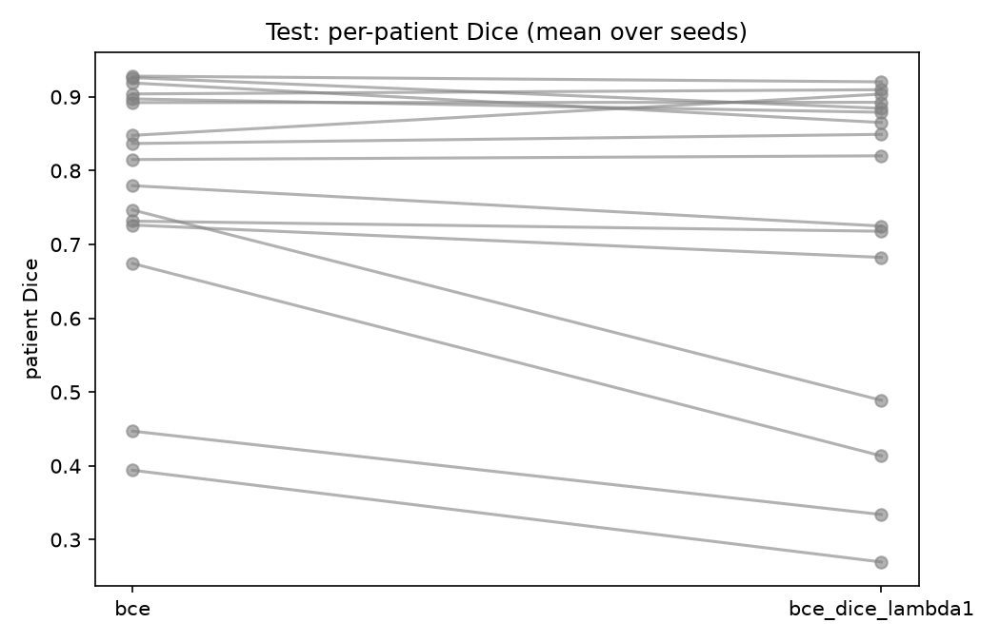
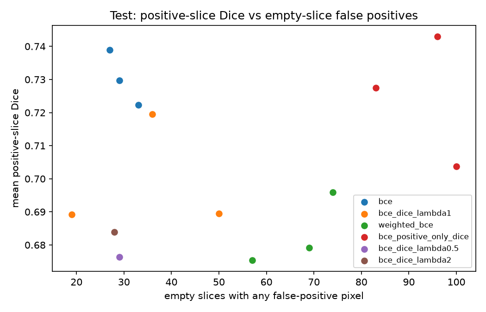
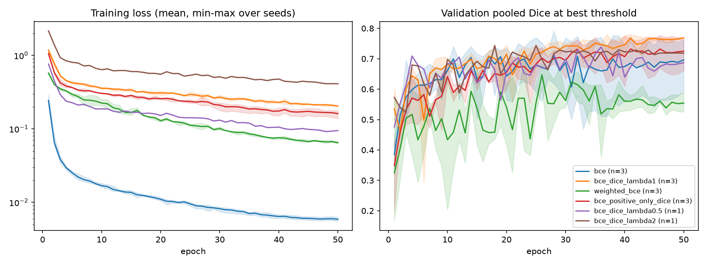
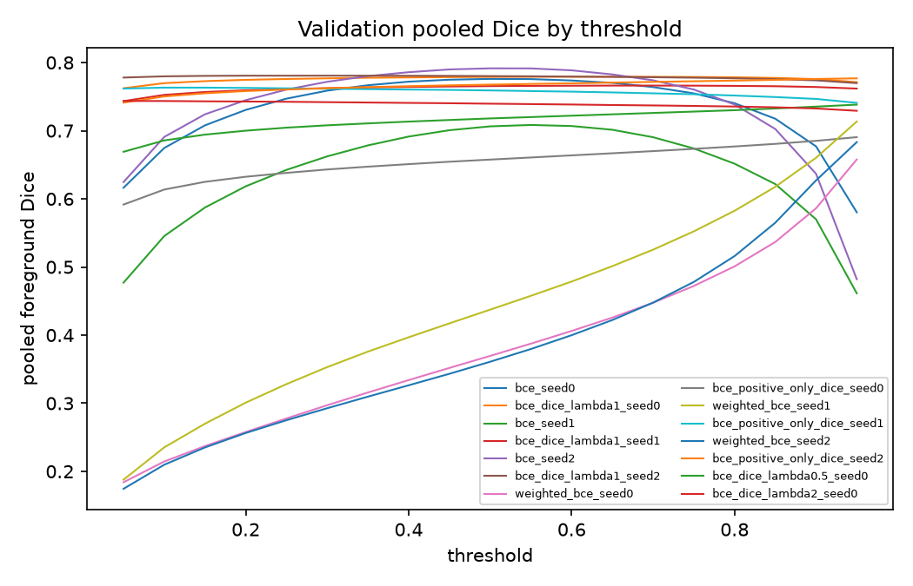
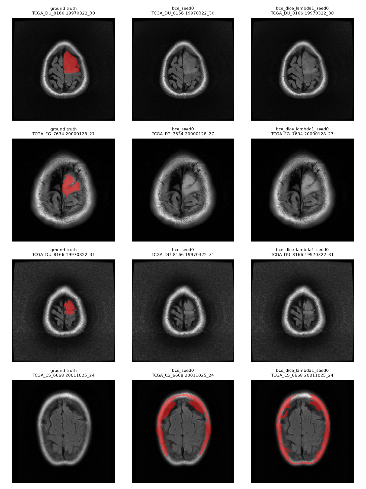

# Does Adding Soft Dice Loss to BCE Improve Brain MRI Tumour Segmentation? A Controlled Study on the LGG Dataset

**Ajay Uppu** · MS Data Science & Analytics, Georgia State University · Machine Learning, Project 1 · November 2026

**Abstract.** I trained a 2D U-Net from scratch on the LGG brain MRI dataset and asked whether adding a batch-pooled soft Dice term to binary cross-entropy (BCE) improves segmentation of tumour-related regions without adding false positives on empty slices. All 14 runs shared the same architecture, data split and training budget. Epochs and thresholds were selected on validation data only, and the frozen methods were evaluated on the test set exactly once. On validation, BCE + Dice had a slightly higher mean pooled Dice (0.775 vs 0.759) and a much smaller seed spread (SD 0.008 vs 0.044). On the test set the order reversed: BCE scored 0.829 ± 0.010 against 0.791 ± 0.027 for BCE + Dice, and BCE + Dice was worse for 11 of the 16 test patients. Neither split showed the predicted gain in positive-slice Dice. The hypothesis is therefore not supported. The diagnostic runs, the threshold analysis and the lesion-size analysis show why the answer is mixed and where the model still fails.

## 1. Introduction and Question

Each input is a 256 × 256 three-channel MRI slice, and the target is a binary mask of the annotated abnormality. The data are strongly imbalanced. Only 35.1% of training slices contain any lesion, and lesion pixels make up 1.06% of all training pixels (Table 1). With pixel-wise BCE, the many easy background pixels can dominate the gradient. Dice-type losses optimise region overlap directly and are a common remedy (Milletari et al., 2016). They can, however, behave poorly on slices with no lesion. A 50-epoch BCE pilot run, used only to motivate the study, reached a validation pooled Dice of 0.791 but a positive-slice Dice of only 0.606, and at least one validation patient scored a Dice of 0. These numbers suggested a real trade-off worth testing.

**Research question.** *Does adding batch-pooled soft Dice loss to BCE improve positive-slice Dice, without increasing false positives on empty slices, compared with BCE alone, when the U-Net, training budget and patient-disjoint data are kept the same?*

**Evidence that would contradict the hypothesis** (fixed in the proposal before any run): (i) the gain falls within seed-to-seed variation; (ii) a simpler reweighting (weighted BCE) gives a similar gain; (iii) empty slices with false positives increase. **Scope:** one architecture, one dataset and the course split. This is a controlled loss-function comparison, not a clinical validation.

## 2. Dataset and Preprocessing

**Data and split.** I used the LGG Segmentation Dataset (Buda et al., 2019): 3,929 image–mask pairs from 110 patients, with the course-provided patient-level split left unchanged. `scripts/01_prepare_data.py` checks the split against the course `patient_splits.csv` and stops on any mismatch. The audit found no patient shared between splits, no duplicate image hashes across splits and no missing files. Test labels are not read by the audit.

*Table 1. Data audit (from `results/tables/data_audit_splits_and_labels.md`). Test label statistics are not computed before the method is frozen.*

| Split | Patients | Slices | Positive slices | Empty slices | Positive fraction | Foreground pixel fraction | Median lesion area (px) |
|---|---:|---:|---:|---:|---:|---:|---:|
| Train | 77 | 2,763 | 969 | 1,794 | 0.351 | 0.0106 | 1,584 |
| Validation | 17 | 598 | 204 | 394 | 0.341 | 0.0081 | 1,148.5 |
| Test | 16 | 568 | 200* | 368* | – | – | – |

\*Counted at the one-time test evaluation (`results/test/test_results.json`).

**Findings relevant to the question.** Lesion size varies widely. Training lesions span 23–7,683 pixels, with a 10th percentile of 336 pixels. Validation lesions are smaller (median 1,148.5 vs 1,584 pixels; `results/figures/data_lesion_area_distribution.png`). Every patient has at least one positive slice, so an empty slice does not mean the patient is healthy. Because two-thirds of slices are empty, the always-empty mask reaches a mean slice Dice of 0.659 on validation (0.648 on test) and a pixel accuracy of 0.992. This is why I report pooled and positive-slice metrics as the primary results.

**Preprocessing.** Images stay at their native 256 × 256 resolution, and the three MRI sequences (pre-contrast, FLAIR, post-contrast) are used as channels. Masks are binarised with `> 0`. Per-channel mean and standard deviation are fitted on the 2,763 training images only (`train_channel_statistics.json`, `fitted_on: train`) and applied to every split. Training augmentation is a horizontal flip and 90° rotations, applied identically to image and mask. Each sample's randomness comes from a generator keyed by (seed, epoch, index). This fixes a bug found in the pilot, where data-loader workers repeated the same random stream. All metrics are computed against the original 256 × 256 masks.

## 3. Baselines and Proposed Approach

- **Trivial reference:** an always-empty mask. It sets a lower bound and exposes metrics that empty slices can inflate.
- **Learned baseline (BCE):** a 2D U-Net (Ronneberger et al., 2015) implemented from scratch: 3 input channels, widths 32–512, four pooling stages, skip connections, 7,763,041 trainable parameters and no pretrained weights. Trained with BCE.
- **Proposed (BCE + Dice, λ = 1):** L = BCE + λ·(1 − soft Dice), with the soft Dice pooled over the whole batch, so slices without a lesion still contribute to the overlap term.
- **Diagnostic 1, weighted BCE:** BCE with a positive-class weight of min((1 − f)/f, 100) = 93.58, where f is the training foreground fraction. This tests the simpler explanation "just up-weight the tumour pixels".
- **Diagnostic 2, BCE + positive-only Dice:** the same loss, but the Dice term is computed only on slices that contain a lesion. This isolates the role of empty slices in the Dice term.
- **Sensitivity:** BCE + Dice with λ = 0.5 and λ = 2.

**Implemented, reused and modified work.** I implemented the U-Net, losses, metrics, training loop, selection, freeze and test-once tooling, figures and tests in `src/brain_mri_segmentation/`. Reused components are the course dataset, split and manifests (unchanged), the published U-Net architecture and soft-Dice formula, and standard libraries (PyTorch, NumPy, pandas, tifffile, Matplotlib, PyYAML, Pillow). The protocol and hyperparameters carry over from my earlier study code for this project, rewritten into a cleaner package. The README section "Reused vs modified work" gives the full account.

## 4. Experimental Setup

**Equal budget.** Every run uses the same model and data, 50 epochs, batch size 16, AdamW (learning rate 10⁻³, weight decay 10⁻⁴), a cosine learning-rate schedule and 4 data-loader workers. Only the loss and the seed change, which is checked by `tests/test_configs_and_parallel.py`. There are 14 runs: BCE, BCE + Dice, weighted BCE and positive-only Dice, each with seeds 0, 1 and 2, plus λ = 0.5 and λ = 2 at seed 0.

**Hardware and runtime.** Training ran in Amazon SageMaker Studio JupyterLab on an ml.g6e.12xlarge instance with 4 × NVIDIA L40S (46 GB) GPUs, one run per GPU, using Python 3.13, PyTorch 2.12 and CUDA 13.0. Each run took 707–731 s (mean 717 s), or 2.79 GPU-hours in total. All 14 runs finished in 48 minutes of wall-clock time (8:26–9:14 PM ET, 24 Nov 2026; `results/logs/train_all.log`). cuDNN was not forced to be deterministic, so the seed controls initialisation and data order but GPU results are not bit-for-bit reproducible.

**Validation-only selection.** After each epoch, the validation set is scored at thresholds 0.05–0.95 (step 0.05). The checkpoint is the epoch with the highest pooled foreground Dice at its best threshold, and the threshold is then re-selected on that checkpoint. The same rule applies to every run, and a selection at the edge of the grid is flagged.

**Freeze, then test once.** `04_freeze_method.py` recorded SHA-256 hashes of all 14 checkpoints, thresholds, normalisation files, configs, the evaluation code and the data manifests (9:17 PM ET). `05_evaluate_test_once.py` verified these hashes, claimed the test set with a lock file, predicted from test images before reading any test mask and logged the attempt. The ledger shows exactly **one** completed attempt, which took 18 s. No modelling decision used test labels.

**Metrics.** Pooled foreground Dice = 2TP/(2TP+FP+FN) and pooled IoU = TP/(TP+FP+FN) over all slices. Mean positive-slice Dice is computed on slices with a non-empty ground truth. Empty-slice errors are the number of empty slices with any false-positive pixel, plus the false-positive pixel total. Patient-level Dice is reported as mean, median and minimum. Pixel accuracy is context only. Per-slice convention: both empty = 1, only one empty = 0. For conditions with three seeds I report the mean ± SD over seeds.

## 5. Results

### 5.1 Validation selection and the main comparison

*Table 2. Validation (selected epoch and threshold) and one-time test results, mean ± SD over seeds (n = 3 unless marked n = 1). "Empty FP" = empty slices with any false-positive pixel (validation 394 empty slices, test 368). Sources: `results/tables/validation_summary_by_condition.md`, `results/tables/test_summary_by_condition.md`.*

| Condition | Val pooled Dice | Val pos-slice Dice | Val empty FP | Test pooled Dice | Test pooled IoU | Test pos-slice Dice | Test empty FP | Test patient Dice (mean / min) |
|---|---:|---:|---:|---:|---:|---:|---:|---:|
| Always-empty | 0.000 | 0.000 | 0 | 0.000 | 0.000 | 0.000 | 0 | 0.000 / 0.000 |
| **BCE** (baseline) | 0.759 ± 0.044 | 0.591 | 37.7 | **0.829 ± 0.010** | 0.708 | **0.730** | **29.7** | **0.779** / 0.305 |
| **BCE + Dice λ=1** (proposed) | **0.775 ± 0.008** | 0.581 | 26.7 | 0.791 ± 0.027 | 0.655 | 0.699 | 35.0 | 0.722 / 0.158 |
| Weighted BCE | 0.685 ± 0.028 | 0.571 | 74.7 | 0.746 ± 0.010 | 0.595 | 0.684 | 66.7 | 0.681 / 0.096 |
| BCE + pos-only Dice | 0.744 ± 0.046 | 0.590 | 105.7 | 0.788 ± 0.048 | 0.652 | 0.725 | 93.0 | 0.729 / 0.320 |
| BCE + Dice λ=0.5 (n=1) | 0.738 | 0.523 | 23 | 0.792 | 0.656 | 0.676 | 29 | 0.706 / 0.083 |
| BCE + Dice λ=2 (n=1) | 0.744 | 0.526 | 29 | 0.796 | 0.661 | 0.684 | 28 | 0.704 / 0.000 |

On validation, BCE + Dice had the highest mean pooled Dice (+0.017 over BCE) and the smallest seed spread, and it produced fewer empty-slice false positives (26.7 vs 37.7). The +0.017 gap, however, is well inside BCE's seed SD of 0.044. The primary outcome named in the question, positive-slice Dice, was not higher with Dice (0.581 vs 0.591). Validation therefore already met contradiction criterion (i).

On the test set, BCE was better on every primary metric: pooled Dice 0.829 vs 0.791, positive-slice Dice 0.730 vs 0.699, and 29.7 vs 35.0 empty slices with false positives. BCE won for every seed (seed 0: 0.818 vs 0.804; seed 1: 0.832 vs 0.760; seed 2: 0.837 vs 0.809). The proposed loss therefore lowered test overlap and *increased* empty-slice false positives, which meets criterion (iii) as well.

<figure><figcaption>Figure 1. Test Dice per patient, averaged over the three seeds of each condition (16 patients). Most lines slope down from BCE to BCE + Dice. Source: <code>results/tables/test_paired_patient_dice.md</code>.</figcaption></figure>

**Paired patient analysis.** Because slices from one patient are correlated, I also compared patients directly (Figure 1). On test, BCE + Dice was worse for 11 of 16 patients (mean difference −0.057, median −0.030). The largest losses were −0.261 (TCGA_DU_5853) and −0.258 (TCGA_CS_6290). An exploratory Wilcoxon signed-rank test, not part of the original plan, gives p = 0.018. On validation the paired differences are centred on zero (7 better, 9 worse, 1 tie; mean +0.001, p = 0.90).

### 5.2 Diagnostic comparisons

**Weighted BCE does not explain any effect.** It was the weakest learned loss on both splits (test 0.746 ± 0.010), with roughly twice BCE's empty-slice false positives (66.7 vs 29.7). Simple reweighting therefore does not reproduce a Dice-like gain, so criterion (ii) is not triggered. There was also no Dice gain to explain. Its operating point was also badly shifted (Section 5.4).

**Empty slices matter inside the Dice term.** Removing empty slices from the Dice term (positive-only Dice) kept positive-slice Dice close to BCE on test (0.725 vs 0.730) but tripled the empty-slice false positives (93.0 vs 29.7 for BCE and 35.0 for BCE + Dice). It was also the least stable condition (test SD 0.048). Including empty slices in the batch-pooled Dice term therefore acts mainly as a false-positive suppressor. Figure 2 shows this trade-off: the positive-only Dice runs sit far to the right, while BCE sits top-left.

<figure><figcaption>Figure 2. Test trade-off for every run: mean positive-slice Dice against the number of empty slices with any false-positive pixel. Top-left is best.</figcaption></figure>

### 5.3 Stability and sensitivity

**Seeds.** The seed spread is as large as the effect being tested. On validation, BCE ranged from 0.708 (seed 1) to 0.792 (seed 2), while BCE + Dice stayed within 0.766–0.781. On test, the stability reversed: BCE had an SD of 0.010 and BCE + Dice 0.027, with BCE + Dice seed 1 dropping to 0.760. The training curves (Figure 3) show validation Dice fluctuating by several points from epoch to epoch for every loss, so the selected epoch carries noise of its own. For example, BCE seed 1 was selected at epoch 21 of 50.

**Dice weight.** Changing λ from 1 to 0.5 or 2 gave test pooled Dice of 0.792 and 0.796, both inside the λ = 1 seed range (0.760–0.809) and below every BCE seed. On validation, both were lower than λ = 1 (0.738 and 0.744 vs 0.775). The negative result is therefore not specific to λ = 1 within this range. With one seed each, though, these are indications rather than firm estimates.

<figure><figcaption>Figure 3. Training loss (log scale) and validation pooled Dice at the best threshold per epoch; lines show the mean and bands the min–max over seeds.</figcaption></figure>

### 5.4 Threshold selection and calibration

Seven of the 14 runs chose a threshold at the edge of the grid: all three weighted BCE runs, two of the three positive-only Dice runs and λ = 0.5 at 0.95, and λ = 2 at 0.05 (`experiment_record.md`, column `selected_threshold_is_grid_edge`). None of the main-comparison runs did. For weighted BCE, the edge threshold of 0.95 improved validation Dice by 0.28–0.32 over 0.5, and the curve was still rising at 0.95 (Figure 4). The positive weight of 93.6 pushes probabilities upward, so the true optimum probably lies above the searched range. The weighted BCE results are therefore a lower bound under this protocol, not its best possible performance. By contrast, the BCE + Dice sweeps are nearly flat (range 0.011–0.023 Dice across the whole grid), while BCE varies by 0.20–0.31. Dice training produces near-binary outputs, which leaves threshold selection little to correct.

<figure><figcaption>Figure 4. Validation pooled Dice against decision threshold for each run at its selected epoch. The weighted BCE curves (bottom) are still rising at 0.95, the upper edge of the grid.</figcaption></figure>

## 6. Discussion and Conclusions

**What the experiments show.** Under an equal budget, validation-only selection and a single test evaluation, adding batch-pooled soft Dice to BCE did **not** improve positive-slice Dice on either split, and it did not reliably reduce empty-slice false positives. It reduced them on validation and increased them on test. On the held-out patients, plain BCE was better on pooled Dice, positive-slice Dice, empty-slice false positives and worst-patient Dice. The hypothesis is not supported. What Dice did provide is more stable validation scores and threshold-insensitive outputs.

**Why validation and test disagree.** I considered four explanations, each grounded in the saved results. (1) *Small samples:* 17 validation and 16 test patients. A few patients decide the ranking: two test patients account for more than half of the summed per-patient deficit of BCE + Dice. (2) *Selection noise:* the epoch and threshold are both chosen to maximise validation Dice, and per-epoch validation Dice moves by several points (Figure 3). Validation scores are therefore optimistic and noisy, which is consistent with BCE seed 1 scoring 0.708 on validation but 0.832 on test. (3) *Different lesion mixes:* 45% of validation positive slices are in the smallest training tertile (92 of 204), against 31% on test (62 of 200). This explains why every method scores higher on test, and it changes which errors dominate. (4) *Seed variance:* the BCE + Dice seed 1 test result (0.760) alone moves the condition mean by about 0.02. These explanations do not rescue the hypothesis. They mean that the validation advantage of Dice was never larger than the noise.

**Failure and subgroup analysis.** Small lesions are the main failure mode for every loss. Using training-tertile cut-offs (≤ 1,038 px small, > 2,350.67 px large), BCE seed 0 reached a mean slice Dice of 0.36 on small validation lesions against 0.83 on large ones. Condition means on validation were 0.35 / 0.76 / 0.82 (small / medium / large) for BCE and 0.34 / 0.75 / 0.82 for BCE + Dice, and on test 0.49 / 0.78 / 0.88 and 0.46 / 0.73 / 0.86 (`validation_dice_by_lesion_size.md`; test breakdown computed in the notebook from the saved per-slice files). Dice therefore did not help the small lesions it is often expected to help. Every main-comparison run has a validation patient with a Dice of 0 (TCGA_FG_A60K). The failure overlays (Figure 5) show the two error types. Clearly visible lesions are missed entirely by both losses (rows 1–3), and on some empty slices both models mark a bright rim at the brain–skull boundary (row 4). These are shared failures, and the choice of loss does not address them.

<figure><figcaption>Figure 5. Validation failure cases (ground truth, BCE seed 0, BCE + Dice seed 0). Rows 1–3: missed lesions. Row 4: false positives along the skull rim on an empty slice.</figcaption></figure>

**Trade-offs.** BCE + Dice: stable on validation and robust to the threshold, but lower test overlap. BCE: best test overlap and fewest false positives, but sensitive to the seed and threshold on validation. Positive-only Dice: competitive positive-slice Dice at the cost of about three times as many false alarms. Weighted BCE: poorly calibrated, so it depends on the threshold range.

**Limitations.** The test set has 16 patients, so a difference of a few hundredths could reverse with another sample, and the p-value above is exploratory. The sensitivity runs use one seed. The threshold grid was too narrow for weighted BCE and some Dice variants. GPU training is not bit-for-bit deterministic. The study covers one 2D architecture with no post-processing and no 3D context. Lesion-size groups use training tertiles, which differ from the audit's fixed `< 100 px` "small lesion" count (21 training slices).

**Conclusion and next steps.** For this U-Net and split, plain BCE is the better choice, and the commonly assumed benefit of adding Dice did not appear on held-out patients. This negative result informs the next decisions: (1) widen the threshold grid or calibrate the outputs before comparing reweighted losses; (2) use more seeds or patient-level cross-validation inside the training set to make selection less noisy; (3) target small lesions directly (higher resolution near the lesion, 2.5D context, or lesion-aware sampling) rather than changing the global loss.

## References

1. M. Buda, A. Saha, M. A. Mazurowski. Association of genomic subtypes of lower-grade gliomas with shape features automatically extracted by a deep learning algorithm. *Computers in Biology and Medicine* 109 (2019) 218–225. Data: TCIA TCGA-LGG; Kaggle `mateuszbuda/lgg-mri-segmentation` (CC BY-NC-SA 4.0).
2. O. Ronneberger, P. Fischer, T. Brox. U-Net: Convolutional networks for biomedical image segmentation. *MICCAI* 2015.
3. F. Milletari, N. Navab, S.-A. Ahmadi. V-Net: Fully convolutional neural networks for volumetric medical image segmentation. *3DV* 2016.
4. A. Paszke et al. PyTorch: An imperative style, high-performance deep learning library. *NeurIPS* 2019.

## Appendix A. Claims-to-Evidence Table

All paths are relative to the repository root. `notebooks/01_results_walkthrough.ipynb` re-reads these files and prints every number used here.

| Claim | Evidence file(s) |
|---|---|
| Course split used unchanged, no patient overlap, no duplicates | `results/data_preparation/data_audit.json` (`checks`, `problems: []`) |
| Normalisation fitted on training images only | `results/data_preparation/train_channel_statistics.json` |
| Same budget, 7,763,041 parameters, L40S, 707–731 s per run | `results/tables/experiment_record.md`, `results/runs/*/run_summary.json` |
| Epoch and threshold selected on validation only | `results/validation/<run>/selection.json`, `threshold_sweep.csv` |
| 7 of 14 thresholds at the grid edge | `results/tables/experiment_record.md` (`selected_threshold_is_grid_edge`) |
| Method frozen before test; one test attempt | `results/frozen_method/frozen_method_manifest.json(.sha256)`, `results/test/test_evaluation_ledger.json`, `results/test/test_evaluation.lock` |
| Validation: BCE + Dice 0.775 ± 0.008 vs BCE 0.759 ± 0.044 | `results/tables/validation_summary_by_condition.md` |
| Test: BCE 0.829 ± 0.010 vs BCE + Dice 0.791 ± 0.027; empty FP 29.7 vs 35.0 | `results/tables/test_summary_by_condition.md`, `results/test/test_results.json` |
| BCE + Dice worse for 11/16 test patients | `results/tables/test_paired_patient_dice.md`, `results/figures/test_paired_patient_dice.png` |
| Positive-only Dice: 93.0 empty FP on test | `results/tables/test_summary_by_condition.md` |
| λ = 0.5 / 2 within the λ = 1 seed range on test | `results/tables/test_summary_by_run.md` |
| Small lesions are the main failure mode | `results/tables/validation_dice_by_lesion_size.md`, notebook section 8, `results/figures/validation_failure_overlays.png` |
| Training logs for every run | `results/runs/<run>/training.log`, `metrics.csv`, `results/logs/train_all.log` |

## Appendix B. Attribution and Use of Assistance

The dataset, split and manifests were provided by the course and used unchanged. The U-Net architecture and the soft-Dice formula follow references 2 and 3 and were implemented from scratch, with no pretrained weights or copied implementations. Libraries: PyTorch, NumPy, pandas, SciPy, tifffile, Matplotlib, PyYAML, Pillow. An AI assistant was used for coding support (writing and restructuring code, tests and documentation) and for drafting text. I ran the experiments, checked the results against the saved files and am responsible for every claim in this report.
